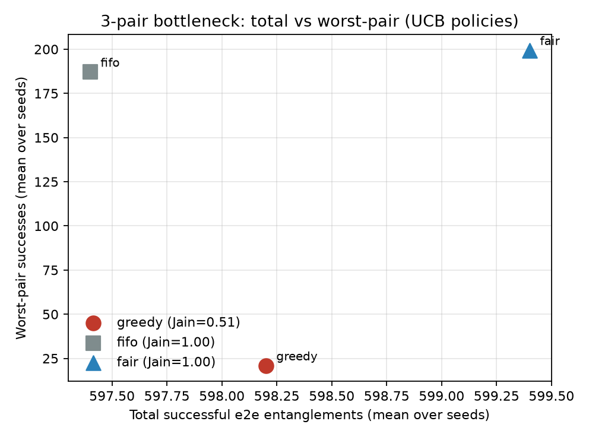

# fair-quantum-routing

Fair multi-pair entanglement routing under **exclusive** link contention — a mentorship proof-of-work for John C.S. Lui (CUHK CSE), adjacent to BeQuP (*Learning Best Paths in Quantum Networks*, INFOCOM 2025 / [arXiv:2506.12462](https://arxiv.org/abs/2506.12462)).

Question: **when several BeQuP-style pairs compete for the same links, who starves?** — not a BeQuP reproduction.

## Headline



See `results/fairness_table.csv`, `results/oracle_regret.csv`, `results/drift.csv`.

## What this claims

**Can claim**

- Under exclusive all-or-nothing multi-pair contention with a **shared sliding-window UCB** and **no fallback**, selfish greedy-UCB wins total throughput but starves the worst pair.
- Cumulative **deficit-fair** trades a little total for much higher worst-pair throughput and Jain index.
- **FIFO/RR** is allocation-fair but path-dumb (same UCB BestPath proposal; only conflict order differs) and wastes the bottleneck slot.
- Low contention (1 pair): policies tie.
- After mid-run drift, sliding-window UCB can re-learn (windowed / post-drift same-policy regret in CSV).

**Cannot claim**

- BeQuP / NetSquid reproduction or hardware realism.
- That \(p_\ell\) is fidelity — it is **link entanglement success probability per slot**; path succeeds iff all links succeed.
- Purification, swap fidelity degradation, or inter-domain QBGP / QPSEL (mentored growth).
- That deficit-first is optimal max-min.
- Cross-comparing fair-UCB regret to a greedy oracle (confounds fairness with learning).
- That losers update link estimates, or that pairs retry a detour the same round (**no fallback**).

## Locked design choices

| Choice | Setting |
|--------|---------|
| Contention | Exclusive slots; all-or-nothing path grant |
| Learning | **One shared** sliding-window UCB per link; optimistic init 1.0 |
| Proposal | Single UCB BestPath among **k=3** shortest-hop candidates; **no fallback** |
| Policies (plot) | greedy (path-UCB order), FIFO (RR token), fair (cumulative deficit) |
| Oracle | Same policy, true \(p\); table only — 2×2 `{greedy,fair}×{UCB,oracle}` |
| Topology | Fixed 3×3 grid; 3 pairs `(0,5),(3,2),(6,5)` |

### Pinned \(p\) map (engineered bottleneck)

| Edge class | Edges | \(p_\ell\) |
|------------|-------|-----------|
| Centre | `(3,4)` | **0.9** |
| Parallel crossings | `(0,1)`, `(6,7)` | **0.5** |
| Other | remaining 9 edges | **0.8** |

Topology alone does not force sharing — this \(p\) map does. Drift (mid-run): centre → 0.4, parallels → 0.9.

### Deficit / FIFO

- Deficit at round start: \((\sum_j s_j)/n - s_i\) (cumulative, not EWMA).
- FIFO pairs also propose UCB BestPath; only grant order is round-robin.

## Quick start

```bash
cd fair-quantum-routing
python -m venv .venv
.\.venv\Scripts\activate   # Windows
pip install -e ".[dev]"
pytest -q
python -m fair_qroute.experiment --out results
```

No NetSquid / Qiskit required. Runs use `T=1000` rounds × 10 seeds by default.

## Growth (not this PoW)

- NetSquid backend behind `NetworkModel`
- Separate \(p_\ell\) vs fidelity \(F_\ell\) + swap degradation
- Max-min fair allocation; QPSEL / QBGP inter-domain path selection (ToN 2026)
